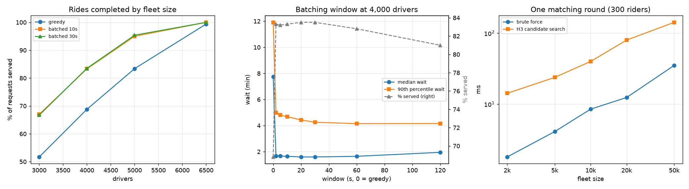

# dispatchsim — Ride Dispatch on Real NYC Demand

A ride-hailing dispatch simulator driven by **61,796 real taxi requests**: Manhattan, Wednesday March 9, 2016, 5–8 pm,
from the NYC TLC trip records. It compares matching each rider to the nearest driver the instant they request
(greedy) with collecting requests for a few seconds and solving one optimal assignment (batched matching). It finds
candidate drivers with **H3**, Uber's hexagonal spatial index, and measures rider wait, rides completed, empty
"deadhead" driving, driver utilization, and matching speed.



## Results

**Batched matching serves far more riders, far faster, at every fleet size** (`results/experiments.json`):

| Drivers | Policy | Rides completed | Median wait | 90th-pct wait | Distance driven empty |
|---|---|---|---|---|---|
| 3,000 | greedy | 51.7% | 8.5 min | 12.1 min | 30.7% |
| 3,000 | batched (30 s) | **66.7%** | **1.7 min** | 3.6 min | 8.4% |
| 4,000 | greedy | 68.8% | 7.7 min | 11.9 min | 28.6% |
| 4,000 | batched (30 s) | **83.5%** | **1.6 min** | 4.3 min | 10.8% |
| 5,000 | greedy | 83.4% | 6.9 min | 11.7 min | 26.8% |
| 5,000 | batched (30 s) | **95.4%** | **1.5 min** | 5.4 min | 13.1% |
| 6,500 | greedy | 99.4% | 4.4 min | 10.8 min | 23.3% |
| 6,500 | batched (30 s) | **100%** | **1.1 min** | 4.1 min | 11.2% |

Wait is the time from request to pickup: waiting to be matched, plus the driver's drive over.

**Why greedy does so badly: the "wild goose chase".** Greedy sends the nearest *idle* driver, however far.
When supply is tight that driver is often 8–10 minutes away, and the long empty drive takes them out of service,
so the next riders find even fewer drivers nearby. Greedy drivers spent 23–31% of their distance driving empty,
against 8–13% under batching.

Capping greedy's pickup distance at 5 minutes tests that explanation:
- At 4,000 drivers, completed rides rise from 68.8% to 75.2% and empty driving falls from 28.6% to 18.6%.
- At 6,500 drivers, median wait falls from 4.4 to 3.0 minutes.

That is about half the gap. The rest is batching itself: deciding many riders and drivers jointly instead of
first come, first served (`results/greedy_capped.json`).

**How long to batch** (4,000 drivers; greedy is a window of 0):

| Window | 2 s | 5 s | 10 s | 20 s | 30 s | 60 s | 120 s |
|---|---|---|---|---|---|---|---|
| Rides completed | 83.3% | 83.2% | 83.3% | 83.5% | 83.5% | 82.8% | 81.0% |
| Median wait (min) | 1.7 | 1.7 | 1.6 | 1.6 | 1.6 | 1.6 | 1.9 |
| 90th-pct wait (min) | 5.0 | 4.8 | 4.7 | 4.4 | 4.3 | 4.2 | 4.2 |

Even a 2-second batch captures nearly all of the benefit. Longer windows trim the slowest pickups a little until
about 30 s; past a minute, riders spend longer waiting for the batch than they save, and completed rides drop.

**Matching speed: an honest negative.** For one matching round of 300 waiting riders, both methods found an
assignment of identical total cost at every fleet size, but brute force was faster:

| Fleet | 2k | 5k | 10k | 20k | 50k |
|---|---|---|---|---|---|
| H3 candidate search (ms) | 14 | 24 | 40 | 80 | 142 |
| Brute force, all idle drivers (ms) | 1.8 | 4.1 | 8.5 | 12.4 | 35 |

Brute force is one vectorized NumPy computation over every rider–driver pair. My H3 path walks hexagon rings
rider by rider in Python, and that loop overhead dominates up to 50,000 drivers. H3's advantage, touching only
nearby drivers, would show in a compiled matcher, at city scale with millions of drivers, or when distance
calculations are expensive (real road routing instead of a straight-line estimate). In the simulator it still
keeps each greedy lookup local, and the tests check it never misses the best driver.

## How it works

- **Demand** (`data.py`): TLC yellow-taxi trips with pickup and drop-off both in Manhattan. The TLC's public files
  give taxi *zones*, not coordinates, so each endpoint is placed uniformly at random inside its zone. Zones are a few
  blocks across, so positions are accurate to roughly half a kilometer. Request times and ride durations are the
  recorded ones. Speed (14.3 km/h) and the road-detour factor (1.18) are calibrated from the same evening's trips.
- **Simulation** (`sim.py`): one-second steps.
  - A rider waits up to 3 minutes to be matched.
  - A driver is never sent more than 10 minutes away.
  - A matched driver drives to the pickup, carries the rider for the trip's real duration, and becomes idle at the
    drop-off.
- **Spatial index:** idle drivers are kept in H3 cells at resolution 8 (about 0.46 km edges). A search covers
  exactly the rings needed to reach the 10-minute limit. A test checks that this is never too small, and another
  that results match a brute-force search exactly.
- **Batched matching:** a rider-by-driver cost matrix of pickup ETAs, solved with the Hungarian algorithm (SciPy's
  `linear_sum_assignment`), with unreachable pairs excluded.
- **A performance fix that had to stay exact.** Re-checking every waiting rider every second made greedy runs take
  minutes. Now a rider who already failed is re-checked only when a driver frees up within their search radius,
  and the queue keeps its first-come, first-served order. An early version broke that order and changed the
  results, which the comparison against the unoptimized run caught.

## Run it

```bash
uv sync
uv run python bench/experiments.py   # downloads and checksum-verifies the TLC data (~170 MB), runs everything,
                                     # writes results/experiments.json and results/experiments.png
uv run pytest                        # synthetic scenarios: index coverage, greedy vs batched, brute-force equality
```

## Limitations

- **No repositioning.** Idle drivers wait where they dropped off; a real platform moves them toward demand. That
  makes both policies look worse and greedy especially, since evening drop-offs pull drivers uptown.
- **Straight-line travel times** scaled by a detour factor, not road routing; rider positions are zone-level.
- **No pricing, pooling or cancellations after matching**, and one evening of one borough.
- Taxi demand is not ride-hail demand, but its time and place pattern is real.

## License and data

Code under MIT (see `LICENSE`). Trip records and zone boundaries are published by the NYC Taxi & Limousine
Commission and are downloaded at run time, not stored here. Built with help from Claude (Anthropic) via Claude
Code; I reviewed, tested and verified the code and results.
